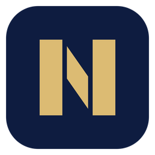

  

<h1 align="center">NOMOS Studio</h1>

El editor de video de Grupo NOMOS: libre, sin marca de agua, sin cuenta y sin suscripción.

NOMOS Studio es una **versión modificada de [Concat](https://github.com/jub0t/Concat)**, el editor de video libre creado por Jareer Abdullah y los colaboradores de Concat. Corre en Windows, macOS, Linux y Android. Todo se procesa en tu equipo: subtítulos automáticos, voz a partir de texto, quitar fondo, animación por fotogramas clave, efectos y títulos, varias pistas y exportación en 4K.

No es una versión oficial de Concat y Concat no la respalda. "Concat" y su logotipo son marcas de su autor ([TRADEMARK.md](TRADEMARK.md)); aquí solo se usan para decir de dónde viene este programa.

## Descargas

Cada versión está en [Releases](https://github.com/georgeblacklancer/nomos-studio/releases), con un instalador por sistema:

| Sistema | Archivo |
| --- | --- |
| Windows | `NOMOS-Studio-<versión>-windows-x86_64-setup.exe` (o `.msi`) |
| macOS | `NOMOS-Studio-<versión>-macos-arm64.dmg` (Apple silicon) o `-x86_64.dmg` (Intel) |
| Linux | `.deb`, `.rpm`, `.AppImage` |
| Android | `NOMOS-Studio-<versión>-android-arm64.apk` |

NOMOS Studio se instala aparte de Concat: usa su propia carpeta de ajustes y modelos (`mx.gruponomos.studio`), así que los dos pueden convivir en el mismo equipo.

## Qué cambia respecto a Concat

Aviso de modificación conforme a la sección 5 de la AGPL-3.0. A partir del 30 de octubre de 2026, Grupo NOMOS modificó Concat 0.2.8 así:

- Nombre, ícono e instaladores propios (NOMOS Studio), con identificadores de aplicación propios en Windows, macOS, Linux y Android.
- Color de acento **Oro NOMOS** como predeterminado; los colores de Concat siguen disponibles en Ajustes › Apariencia.
- La interfaz arranca en español.
- Las actualizaciones, el código y los reportes de problemas apuntan a este repositorio.
- En la pantalla de inicio, la tarjeta «Basado en Concat» lleva al proyecto original.

El historial completo de cambios está en los commits de este repositorio.

## Licencia y código fuente

NOMOS Studio se distribuye bajo la misma licencia que Concat, **GNU AGPL-3.0 o posterior** ([LICENSE](LICENSE)). El código completo de cada versión, con todas nuestras modificaciones, está en este repositorio. Los componentes de terceros y sus licencias están en [THIRD_PARTY_NOTICES.md](THIRD_PARTY_NOTICES.md).

Copyright © 2026 Jareer Abdullah y los colaboradores de Concat.
Modificaciones © 2026 Grupo NOMOS.

## Compilar

Igual que Concat: el espacio de trabajo de Cargo está en `src/`. Consulta la [guía de compilación](src/README.md) y el [README original de Concat](README.concat.md).
